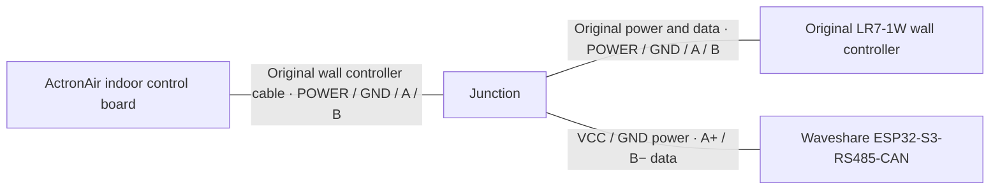

# Implemented features and wiring

**English** · [简体中文](implementation.md) · [Repository home](../README.md)

This page describes the project and bus wiring for the ActronAir Classic Series 2 CRA130S/EVA130S, the original LR7-1W wall controller, and the Waveshare ESP32-S3-RS485-CAN. [RS-485 protocol and register map](protocol.md)

## Implemented features

| Feature | Implementation | Verification |
| --- | --- | --- |
| Bus state synchronization | Parses polls, controller replies, and host broadcasts at 9600/8N1. Validates frame CRCs and updates the cooling state, setpoint, fan speed, and zones. | Passive captures covered original wall controller actions and host broadcasts. |
| System power | Switches cooling on or turns the system off. | Both wall controller transitions and their host broadcasts were observed. The firmware implements the corresponding controls. |
| Shared target temperature | Accepts a system-wide setpoint from 16–30 °C in 0.5 °C increments. | The wall controller's 0.5 °C adjustments and resulting broadcasts were observed. The 16–30 °C range is the software input range. |
| Three fan speeds | Low, medium, and high. | All three states were observed. Request flags were captured for low and medium selections. |
| Five zone switches | Switches zones 1–5 individually. Software requires at least one selected zone. | Changes to all five zone bits were observed. The software blocks turning off the last zone. |
| Mobile PWA | The web app can be added to a phone's home screen. It displays the requested value immediately, receives background updates, combines rapid setpoint changes, and waits for bus confirmation. | Phone layout and consecutive inputs were tested with a simulated device. |
| Apple Home | Provides one shared thermostat, a separate fan speed control, a system power switch, and five zone switches. | The accessory tiles were visible. Pairing and accessory layout were checked after the update. |
| Remote synchronization | ESP32 exchanges state over a persistent WSS connection, reconnects after disconnects, and discards expired operations. | The connection and reconnection were tested on a bench with A/B disconnected. |
| Local setup and diagnostics | Wi-Fi scan and setup, a local status page, wireless logs, and passive bus capture. | Used to read device status and collect original wall controller messages. |
| Firmware updates | USB and local Wi-Fi OTA updates, with a guard for the RS-485 driver enable state during updates. | The current firmware passed OTA and restart checks with A/B disconnected. |

The firmware implements the control paths. Original wall controller testing verified the protocol fields and host broadcasts. The current WSS bench acceptance covered connectivity and pairing. ESP32 command acceptance on the live bus and end-to-end timing still need to be verified for each control.

Implemented HVAC controls cover cooling on/off, a shared setpoint, three fan speeds, and five zone switches. Heating, fan-only mode, per-zone temperature control, timers, and energy-saving modes are outside the implementation. The candidate room temperature field and actual compressor activity still need independent verification.

## One cable split into two parallel branches

The **indoor control board's** existing wall controller cable reaches a junction and splits into two branches. The **LR7 branch** retains the original `POWER`, `GND`, `485 A`, and `485 B` connections. The **Waveshare branch** taps the same four lines. `POWER/GND` go to the board's `VCC/GND` power screw terminals, and `485 A/B` go to its RS-485 terminals. Both devices draw power from the original cable and share the same A/B pair.

| Original cable | LR7 terminal | Waveshare terminal |
| --- | --- | --- |
| `POWER` | `POWER` | Power input `VCC` |
| `GND` | `GND` | Power input `GND` |
| `485 A` | `485 A` | RS-485 `A+` |
| `485 B` | `485 B` | RS-485 `B−` |

The ActronAir wiring diagram labels the wall controller supply `+12 V`. The Waveshare `VCC/GND` terminals are its DC 7–36 V power screw input. The diagram records the terminal mapping. The supply voltage under load and available current for the additional board have yet to be measured. [ActronAir Classic Series 2 indoor installation guide, section 15.01](https://docs.actronair.com.au/wp-content/uploads/0525-074-Install-Guide-Split-Ducted-Indoor-Classic-2-Ver.-10.pdf) · [Waveshare board documentation](https://docs.waveshare.com/ESP32-S3-RS485-CAN)

The diagram describes the low-voltage wall controller side. Verify terminal labels against the exact unit and board, and isolate power to the air conditioner before changing the wiring. The Waveshare 120 Ω jumper setting depends on the actual bus endpoints and existing termination. [Waveshare termination notes](https://docs.waveshare.com/ESP32-S3-RS485-CAN/FAQ)
