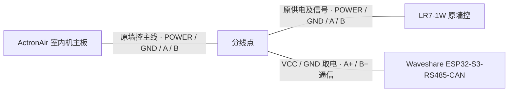

# 已实现功能与接线 / Features and wiring

记录对象为 ActronAir Classic Series 2 CRA130S/EVA130S、原厂 LR7-1W 墙控和 Waveshare ESP32-S3-RS485-CAN。本文说明项目实现和总线拓扑。[RS-485 协议及寄存器表](protocol.md)

## 已实现功能

| 功能 | 当前实现 | 验证范围 |
| --- | --- | --- |
| 总线状态同步 | 解析 9600/8N1 的轮询、墙控回复和主机广播，校验帧 CRC，更新开关、设定温度、风速及分区。 | 原墙控操作及主机状态回报已被动采样。 |
| 全屋空调开关 | 制冷开机与关机。 | 原墙控的两个方向及主机回报已观测，固件实现对应控制。 |
| 统一设定温度 | 软件允许 16–30 °C，每步 0.5 °C，控制全屋共用的设定值。 | 已观测墙控以 0.5 °C 调整并回传。16–30 °C 是软件输入范围。 |
| 三档风速 | 低、中、高三档。 | 三档状态已观测，低速与中速的动作标志已捕获。 |
| 五个分区开关 | 按分区 1–5 独立切换，软件要求至少保留一个分区。 | 五个分区位的开关变化已观测，全部关闭由软件拦截。 |
| 手机 PWA | 网页可添加到手机主屏幕。输入立即显示目标，后台推送状态，连续调温合并，等待总线回报后确认。 | 手机布局和连续操作已用模拟设备验收。 |
| Apple「家庭」 | 一个统一温控卡片、一个独立风速卡片、一个总开关及五个分区开关。 | 配件卡片已显示，升级后核对了配对和配件布局。 |
| 远程同步 | ESP32 通过 WSS 长连接更新状态并在断线后重连，过期操作丢弃。 | A/B 隔离台架测试验证了连接与重连。 |
| 本地设置和诊断 | Wi-Fi 扫描和配网、本地状态页面、无线日志和被动总线采样。 | 已用于读取设备状态和采集原墙控报文。 |
| 固件更新 | 支持 USB 和本地 Wi-Fi OTA，升级流程对 RS-485 驱动启用状态做保护。 | 当前版本在 A/B 断开的条件下通过 OTA 和重启验收。 |

固件实现了控制路径。原墙控实测确认的是协议字段和主机回报。当前 WSS 版本的隔离验收只覆盖网络及配对，ESP32 经总线执行各类指令的结果和端到端延迟仍待逐项验证。

当前控制范围为制冷开关、统一设定温度、三档风速及五个分区开关。制热、纯送风、分区独立控温、定时和节能模式不在实现范围内。室温候选字段和压缩机实际运行状态仍待独立核实。

## 一根主线，一分二并联

从**室内机主板**出来的原墙控主线先到分线点，再分成两路。**LR7 支路**继续接原来的 `POWER`、`GND`、`485 A`、`485 B`。**微雪板支路**也接这四根线，原墙控线的 `POWER/GND` 接到微雪板电源螺丝端子的 `VCC/GND`，`485 A/B` 接到微雪板的 RS-485 端子。两台设备由同一条原线供电，并共享同一对 A/B。

| 原主线 | LR7 墙控端子 | 微雪板端子 |
| --- | --- | --- |
| `POWER` | `POWER` | 电源输入 `VCC` |
| `GND` | `GND` | 电源输入 `GND` |
| `485 A` | `485 A` | RS-485 `A+` |
| `485 B` | `485 B` | RS-485 `B−` |

ActronAir 手册在墙控接线图上标注 `+12 V`。微雪板的 `VCC/GND` 指其 DC 7–36 V 电源螺丝端子。这里记录端子对应关系，现场带载电压和墙控电源可承受的额外负载尚未实测。[ActronAir Classic Series 2 室内机安装手册，第 15.01 节](https://docs.actronair.com.au/wp-content/uploads/0525-074-Install-Guide-Split-Ducted-Indoor-Classic-2-Ver.-10.pdf) · [Waveshare 板卡资料](https://docs.waveshare.com/ESP32-S3-RS485-CAN)

图示记录的是低压墙控侧拓扑。核对端子请以机型和板卡丝印为准，改动布线前应隔离空调电源。微雪板的 120 Ω 跳帽应按实际总线端点和已有终端电阻决定。[Waveshare 终端电阻说明](https://docs.waveshare.com/ESP32-S3-RS485-CAN/FAQ)

## English summary

Implemented controls cover cooling on/off, a shared 16–30 °C setpoint in 0.5 °C increments, three fan speeds, and five zone switches with a minimum of one selected zone. The project provides a mobile PWA, Apple Home accessories, and WSS status updates. Passive captures verified original wall controller actions and subsequent host broadcasts. Current WSS testing covered connectivity with the bus disconnected. ESP32 write acceptance and end-to-end timing remain to be tested for that release.

The indoor unit's four-wire wall controller cable reaches one junction. Both branches carry power, ground, and A/B in parallel. The LR7 uses its original terminals. The Waveshare board uses its DC power screw terminals (`POWER` to `VCC`, `GND` to `GND`) and its RS-485 `A+` and `B−` terminals. The voltage under load and the available current for the additional board have yet to be measured.
